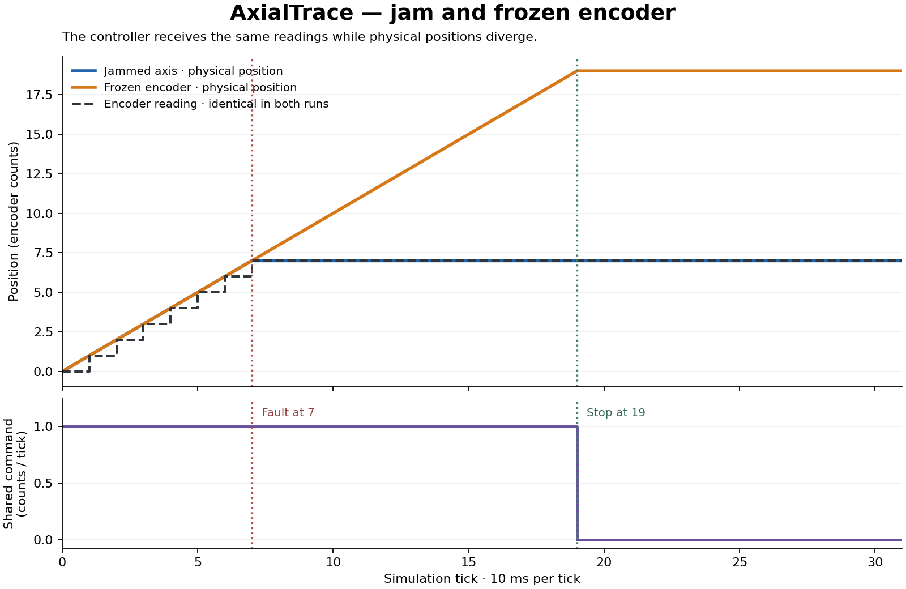

# AxialTrace

**A C++ simulator that moves a virtual robotic axis, introduces faults, and checks whether its controller reacts on time.**

Imagine a motor moving a small carriage along a straight rail. A controller tells it where to go, and a position sensor reports where it is.

What happens if the carriage gets stuck? What if the sensor stops updating while the carriage keeps moving? Can we prove that the controller noticed the problem and requested a stop at the correct moment?

AxialTrace explores these questions through repeatable simulations, recorded measurements, and an independent verification tool.

## What the project does

AxialTrace simulates one linear axis. A linear axis is a mechanism that moves forward and backward along a straight path, such as a sliding stage inside a machine.

During a simulation, the program repeatedly performs five steps.

1. Reads the position sensor.
2. Gives that reading to the controller.
3. Records the controller’s decision.
4. Applies the command to the simulated mechanism.
5. Advances to the next time step.

A fault can be introduced at a chosen moment. The resulting record can then be replayed through a separate verifier to check the controller’s response.

The project runs entirely in software. You can build it, introduce failures, and inspect the results on a computer.

## A simple example

Suppose the controller asks the carriage to move toward position 80.

At position 7, we introduce one of two failures.

| Failure | What physically happens | What the controller sees |
|---|---|---|
| Mechanical jam | The carriage gets stuck at position 7. | The sensor keeps reporting 7. |
| Frozen encoder | The carriage continues moving, but its sensor reading freezes. | The sensor keeps reporting 7. |

An **encoder** is the position sensor in this project.

The controller receives identical information in these two situations. It knows that its movement commands are no longer producing changes in the reported position.

After the permitted observation window, it must request a stop.

The trace records both the sensor reading and the simulated physical position. This lets someone reviewing the run understand what actually happened, even though the controller itself cannot access that physical information.

## Features available now

### Movement in both directions

The axis can move toward a target, reverse direction, and hold when its encoder reports that it has arrived.

Velocity changes are limited. When direction reverses, the mechanism slows through zero before moving the other way.

The simulated rail also has lower and upper travel limits.

### Mechanical jam injection

A jam prevents the actuator from moving from the chosen fault interval onward.

The controller continues receiving position measurements, but those measurements stop changing. This allows us to test its response to a loss of measured movement.

### Frozen sensor injection

The encoder can hold its last reading while the physical mechanism continues responding to commands.

This creates a useful failure case. The controller’s view of the axis becomes different from the simulated physical state.

### Rounded sensor readings

The motion model tracks movement in smaller units than the encoder reports.

As a result, the mechanism can move slightly while several consecutive sensor readings remain unchanged. The slow-motion scenario checks that this normal behavior does not immediately trigger a fault.

### Repeatable CSV traces

Every simulation produces a CSV file containing one row per tick.

The simulation uses a fixed time step and integer arithmetic. Repeating a run with the same arguments produces the same CSV bytes.

### Independent replay verification

A separate verifier reads the recorded commands and measurements, derives when the controller should have stopped, and compares that deadline with its recorded behavior.

It reports the exact tick where a requirement was broken, together with the expected and observed stop ticks.

### Deliberately faulty regression traces

The test suite includes a controller-output experiment that delays the stop decision by one tick.

The verifier must catch that delay. A saved copy of the faulty trace remains in the repository so future changes can be checked against the same failure.

### Automated builds and tests

The project uses CMake and GoogleTest. Its GitHub Actions workflow is configured to build and run the checks on Linux and macOS.

## Why the components are separate

Three components represent different responsibilities.

| Component | Responsibility |
|---|---|
| Controller | Decides the movement command using the target and encoder reading. |
| Actuator | Updates the simulated physical position and velocity. |
| Encoder | Converts physical position into the reading supplied to the controller. |

The controller receives the target and the encoder measurement. Physical position stays outside its interface.

This matters most during a frozen-sensor failure. If the controller could inspect the physical position directly, it would have information that the simulated sensor had failed to provide.

The replay verifier is also separate. It has no dependency on the controller or motion-model library.

## How the stop rule works

The controller checks whether its previous movement command produced a change in the encoder reading.

An interval counts as **quiet** when both conditions hold.

- The previous command requested movement.
- The current encoder reading matches the previous reading.

Measured movement or a preceding zero command resets the quiet interval.

After **12 consecutive quiet intervals**, the controller must set its fault flag and command zero on that same tick. The flag then stays set for the rest of the run.

Each tick represents **10 milliseconds**, giving an observation window of **120 milliseconds**.

A zero command requests deceleration. The fault flag records the controller’s decision to stop because measured movement was lost.

## Why slow movement needs special handling

A rounded sensor cannot report every tiny movement.

For example, the physical mechanism might move through positions 0.1, 0.2, and 0.3 while the encoder continues reporting 0.

Treating every repeated reading as a mechanical failure would produce false alarms.

The slowest supported speed in AxialTrace is 0.1 encoder count per tick. Moving one full count takes 10 ticks. The 12-tick observation window allows that movement to become visible before declaring a feedback fault.

This rule depends on the supported speed, encoder resolution, acceleration, and tick period. Changing those assumptions requires reviewing the observation window.

## What independent verification catches

Consider a trace where the stop should occur at tick 12, but the recorded controller response occurs at tick 13.

The verifier reports:

```text
tick=12 expected_stop=12 observed_stop=13 stop flag missing
tick=12 expected_stop=12 observed_stop=13 nonzero command after stop deadline
```

This identifies both parts of the failure. The controller had not set its stop flag, and it was still requesting movement after the deadline.

The verifier also checks for premature stop flags and for a fault flag being cleared after the deadline.

Physical position and velocity are excluded from the verifier’s retained observations. Its deadline comes from the recorded commands, encoder readings, and declared observation window.

## Build and run

You need:

- A C++17 compiler.
- CMake 3.16 or newer.
- Make.
- Internet access for the first GoogleTest download.

Clone the repository and run the demo script:

```bash
git clone https://github.com/nomaanmunshi/AxialTrace.git
cd AxialTrace
sh demo.sh
```

The script builds the project, runs the tests, generates seven scenario traces, and checks them with the replay verifier.

Generated files are placed in:

```text
build/traces/
```

At the end, the script deliberately verifies a faulty fixture. Its rejection messages are expected. The script succeeds only when that fixture is rejected correctly.

## Available scenarios

| Scenario | What it demonstrates |
|---|---|
| `forward` | Movement toward a target. |
| `reversal` | A target change that reverses movement. |
| `arrival` | Reaching a target and holding. |
| `limits` | Movement toward the upper travel limit. |
| `jam` | A mechanism that physically stops moving. |
| `frozen` | A position sensor that stops updating. |
| `slow` | Legitimate movement between rounded encoder readings. |

Run an individual scenario:

```bash
build/axialtrace jam
```

Save its output and verify it:

```bash
build/axialtrace jam > build/traces/jam.csv
build/axialtrace verify build/traces/jam.csv
```

Change when the fault begins:

```bash
build/axialtrace frozen --fault-tick 20 --ticks 64 > build/traces/frozen20.csv
build/axialtrace verify build/traces/frozen20.csv
```

With the default speed and current 12-tick rule, a fault beginning at tick 20 produces a stop deadline at tick 32 in this scenario.

You can also set the requested speed, in subcounts per tick, between 100 and 1,000.

```bash
build/axialtrace jam --fault-tick 7 --ticks 32 --speed 100 > build/traces/slow-jam.csv
build/axialtrace verify build/traces/slow-jam.csv
```

This slow run stops on tick 17. Its last encoder change occurs on tick 5, so the 12 quiet intervals end at tick 17. Some unchanged readings occur before the fault begins. The deadline follows the measurements available to the controller.

Successful replay output says `checked window only`. A short recording can finish before the stop deadline and still contain no violation.

## Reading a trace

Current traces begin with their format version, tick period, and quiet-interval limit, followed by the CSV header.

```text
# axialtrace,2,step_us=10000,quiet_limit=12
tick,target,encoder,command,position,velocity,stopped
```

| Field | Meaning |
|---|---|
| `tick` | The simulation step number, beginning at zero. |
| `target` | Requested destination in whole encoder counts. |
| `encoder` | Position reported to the controller in whole counts. |
| `command` | Requested velocity in subcounts per tick. |
| `position` | Simulated physical position in subcounts. |
| `velocity` | Simulated physical velocity in subcounts per tick. |
| `stopped` | Whether the controller has latched its feedback-fault flag. |

There are **1,000 subcounts per encoder count**.

Each row records the state at the beginning of its tick. The command on that row is applied during the following interval.

Reaching a target normally produces a zero command while leaving `stopped` at zero. The flag specifically records a feedback fault.

The verifier also accepts original Day 1 traces without the metadata line, using their original four-tick rule.

## Jam and frozen-sensor comparison

The default fault starts at tick 7. Both cases request a stop at tick 19.



The figure uses the committed 32-tick examples in `examples/jam.csv` and `examples/frozen.csv`. The CLI test regenerates these examples and checks their bytes against the committed files.

To regenerate the figure, install Matplotlib into your Python environment and run the plotting tool.

```bash
python3 -m pip install matplotlib
python3 tools/plot_faults.py examples/jam.csv examples/frozen.csv --output docs/jam-vs-frozen.png
```

The plotting tool checks that both recordings have identical targets, measurements, commands and stop flags before creating the comparison.

The table below expresses physical positions in whole encoder counts for readability.

| Tick | Reported position in both runs | Physical position with jam | Physical position with frozen encoder |
|---|---|---|---|
| 7 | 7 | 7 | 7 |
| 8 | 7 | 7 | 8 |
| 18 | 7 | 7 | 18 |
| 19 | 7 | 7 | 19 |

The controller sees the same measurements and makes the same decisions in both runs. The physical outcomes differ because the underlying failures differ.

This is the project’s central ambiguity. Repeated position readings can establish a loss of measured movement, while additional evidence would be needed to identify its physical cause.

## Testing

The current suite contains **30 GoogleTest cases and one CLI integration check**.

Coverage includes:

- Acceleration-limited reversal and both travel limits.
- Target arrival and holding.
- Identical controller feedback during jam and frozen-sensor failures.
- Detection deadlines at different fault start times.
- Slow movement with rounded encoder readings.
- Repeatable output across separate processes.
- Correct and deliberately late stop traces.
- A one-tick delay applied to the current controller’s output.
- Malformed CSV input and missing ticks.
- Command-line diagnostics and exit codes.
- A 256-run fault sweep covering both fault types, two speeds and every start tick in a 64-tick recording.
- Both directions at every integer speed from 100 to 1,000, starting at ten encoder phases.
- Faults after arrival, quiet-window resets and recovery after a latched fault.
- Extreme integer commands during reversal.

The verifier uses three exit codes.

| Code | Meaning |
|---|---|
| `0` | Verification passed. |
| `1` | A recorded requirement violation was found. |
| `2` | Arguments, input format, or file access failed. |

## Project structure

| Path | Contents |
|---|---|
| `src/axis.hpp`, `src/axis.cpp` | Controller, actuator, encoder, scenario runner, and trace export. |
| `src/replay.hpp`, `src/replay.cpp` | CSV reader and independent stop-rule verifier. |
| `src/main.cpp` | Simulation and verification commands. |
| `tests/axis_test.cpp` | Movement, sensor, fault, and determinism tests. |
| `tests/replay_test.cpp` | Verification tests and delayed-stop experiment. |
| `tests/fixtures/` | Saved correct and faulty traces. |
| `tests/cli.cmake` | Command-line integration checks. |
| `demo.sh` | Build, test, scenario generation, and replay checks. |
| `examples/` | Reproducible jam and frozen-encoder recordings. |
| `tools/plot_faults.py` | Comparison figure generated from paired recordings. |
| `docs/validation.md` | Catch-up work, observed results and remaining checks. |
| `.github/workflows/build.yml` | Linux and macOS automation. |

## Planned work

The comparison figure and expanded boundary tests are complete. The next stage is to review the updated build on macOS, record a short terminal walkthrough, and complete the release review.

The release demonstration will change the fault start time, predict the resulting stop deadline, and run the simulation and verifier to check that prediction.

A reviewed `v0.1.0` release will follow that work.

## Modeling assumptions and limits

The actuator uses a simplified kinematic model with bounded velocity changes. It does not model mass, motor torque, backlash, or communication delay.

Targets are whole counts between 0 and 100. Arrival is judged through the rounded encoder, so slow movement can stop within half a count of the physical target.

A latched feedback fault requires a new controller instance to reset.

The verifier trusts the policy declared in the trace metadata and checks the available recording. A recording that ends before a future deadline cannot establish how the controller would respond afterward.

AxialTrace provides a small, inspectable environment for studying movement commands, ambiguous sensor feedback, and the timing of controller decisions.
